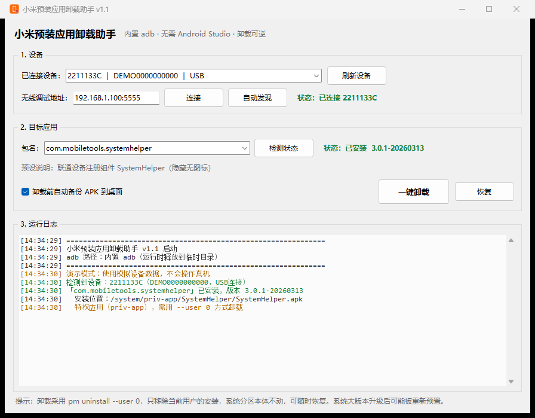

<div align="center">


# 小米预装应用卸载助手

**专治 `SystemHelper` 这类「看不见」的预装应用**

无图标 · 不在应用列表 · 开机自启 · 定期唤醒 · 明文 HTTP 上报设备信息

[](https://github.com/chokoketsu)
[](https://www.python.org/)
[](https://pyinstaller.org/)
[](LICENSE)
[](../../releases)

</div>

---



## 这个工具是从哪来的

起因是一台小米手机上，`/system/priv-app/` 里躺着这么个东西：

```
/system/priv-app/SystemHelper/SystemHelper.apk
包名   com.mobiletools.systemhelper
名称   SystemHelper
版本   3.0.1-20260313
```

它有平台签名、占着 `priv-app` 的位置、默认拿到后台定位和 `READ_PRIVILEGED_PHONE_STATE`，**但桌面上没有图标，应用列表里也翻不到**。只在后台做几件事：开机自启、盯着 SIM 卡和网络状态变化、定时唤醒采信号、判断是不是联通卡，然后往 `http://dm.wo.com.cn:18080/register` 发一个**明文 HTTP** 的 POST。

想清掉它，得连电脑敲一串 `adb shell pm ...`。手滑一次就可能把系统组件摘掉，手机直接开不了机。所以把这套流程做成了图形界面——**adb 也打包进 exe 了**，拷到任何一台 Windows 上双击就能用。

## 功能

| | 功能 | 说明 |
|---|---|---|
| 🔍 | **自动发现设备** | 启动即扫描，显示「机型 ｜ 序列号 ｜ USB/无线」，不用敲 `adb devices` |
| 📶 | **无线调试** | 一键扫局域网内已开无线调试的手机，也支持手动填 `IP:端口` |
| 🩺 | **状态检测** | 目标应用是否安装、版本号、安装路径、是否为特权应用，一目了然 |
| 💾 | **卸载前自动备份** | 把 APK 拉到桌面 `MI卸载备份_时间戳`，并附一份安装态快照 |
| 🧹 | **一键卸载** | `pm uninstall --user 0`，只移除当前用户的安装，**可逆** |
| ↩️ | **一键恢复** | `pm install-existing`，从系统分区原地装回来 |
| 🛡️ | **防误删保护** | 内置核心组件黑名单（系统 UI、桌面、电话、设置…），点不动也输不进去 |
| 🎭 | **演示模式** | `--demo` 启动，用模拟设备数据预览界面，不碰真机 |

## 实战：把 SystemHelper 摘掉

以下就是工具内部实际执行的步骤，你也可以完全手动复现。

**① 先确认它到底在不在**

```bash
adb shell pm path com.mobiletools.systemhelper
# package:/system/priv-app/SystemHelper/SystemHelper.apk   ← 有输出就是装着
```

**② 看看它拿了哪些权限**（这一步最容易看出问题）

```bash
adb shell dumpsys package com.mobiletools.systemhelper | findstr "versionName installed"
```

值得盯的是这几项：`ACCESS_BACKGROUND_LOCATION`、`READ_PRIVILEGED_PHONE_STATE`、`PACKAGE_USAGE_STATS`、`QUERY_ALL_PACKAGES`。

**③ 备份，然后卸载**

```bash
adb pull /system/priv-app/SystemHelper/SystemHelper.apk
adb shell pm uninstall --user 0 com.mobiletools.systemhelper
# Success
```

**④ 复查：是否真没了**

```bash
adb shell pm path com.mobiletools.systemhelper     # 空
adb shell pm list packages -u | findstr mobiletools
# package:com.mobiletools.systemhelper             ← 系统里还有定义，只是当前用户没装
```

`-u` 能看到「已卸载的残留」——这是区分「卸掉了」和「本来就没有」的关键。判断口径：

| `pm path` | `pm list -u` | 含义 |
|---|---|---|
| 有路径 | 有 | 正常装着 |
| 空 | 有 | 已从当前用户移除 |
| 空 | 空 | 系统里压根没这个包 |

**⑤ 后悔了**

```bash
adb shell pm install-existing com.mobiletools.systemhelper
```

## 快速开始

**方式一：直接下载现成的 exe**（推荐）

到 [Releases](../../releases) 下载 `MiUninstaller.exe`，双击运行，无需安装。

> 未购买代码签名证书，Windows 11 可能提示「已保护你的电脑」——点「更多信息」→「仍要运行」。

**方式二：从源码运行 / 自行打包**

```bash
git clone https://github.com/chokoketsu/MiPreinstallUninstaller.git
cd MiPreinstallUninstaller

python src/mi_uninstaller.py       # 直接跑
pip install pyinstaller && python build.py   # 或打成 exe
```

## 界面操作

1. **连接手机**：数据线；或开启「开发者选项 → 无线调试」并与电脑同 WiFi
2. 手机弹「允许 USB 调试吗」→ 勾选「一律允许」→ 允许
3. 启动工具，「已连接设备」出现机型即连上
4. 包名框默认已填 `com.mobiletools.systemhelper`，点「检测状态」
5. 确认「已安装」→ 点「一键卸载」→ 二次确认

## 内置包名预设

下拉框预置了 14 个小米机型上常见、相对安全可移除的包：

| 包名 | 说明 |
|---|---|
| `com.mobiletools.systemhelper` | 联通设备注册组件（隐藏无图标） |
| `com.miui.systemAdSolution` | 系统广告服务 |
| `com.miui.analytics` | 小米分析统计 |
| `com.miui.msa.global` | MSA 广告标识服务 |
| `com.xiaomi.mipicks` | 应用中心推荐 |
| `com.miui.hybrid` | 快应用框架 |
| `com.miui.video` / `com.miui.news` / `com.miui.browser` | 小米视频 / 资讯 / 浏览器 |
| `com.xiaomi.gamecenter` / `com.xiaomi.gsgservice` | 游戏中心 / 游戏服务框架 |
| `com.miui.miservice` | 服务与反馈 |
| `com.iflytek.inputmethod.miui` | 讯飞输入法（小米定制） |
| `com.xiaomi.market` | 小米应用商店 |

也可以手输任意包名。不知道包名就先查：

```bash
adb shell pm list packages | findstr 关键词
```

## 兼容性

**小米 / Redmi / POCO（HyperOS、MIUI）**：已实测，这是主要目标。

**其他 Android 机型**（华为、荣耀、OPPO、vivo、三星、原生 AOSP 等）：理论上同样可用——底层用的就是标准的 `pm uninstall --user 0`，不依赖任何 MIUI 私有接口。但**没有做过实机验证**，厂商对预装应用的锁定策略各不相同，可能遇到 `DELETE_FAILED_INTERNAL_ERROR` 或 `-25`。用之前建议先只点「检测状态」看看，别直接卸。

## 为什么卸载是可逆的

```bash
adb shell pm uninstall --user 0 <包名>
```

它不删除 `/system` 分区里的文件，只是把「这个包对 user 0 安装」标记为 `installed=false`。APK 本体原封不动，所以随时能 `pm install-existing` 装回来。

真正删除需要 Root 或解锁 bootloader 改写系统分区——本工具**不做**这件事。

## 技术实现

- **Python 3.9+ / tkinter** 写界面，无第三方 GUI 依赖
- **PyInstaller `--onefile --windowed`** 打包，内置 `adb.exe` + `AdbWinApi.dll` + `AdbWinUsbApi.dll`
- 运行时把 adb 释放到 `_MEIPASS/adb/`，查找优先级：内置 → 程序同级 `adb/` → 系统 Android SDK → `PATH`
- 所有 adb 调用带 `CREATE_NO_WINDOW`，不会闪黑框
- 耗时操作跑在子线程，UI 不阻塞；关键操作前后都做状态校验
- 关键系统包黑名单在 `PROTECTED_PKGS`，直接拒绝执行

## 常见问题

<details>
<summary><b>提示「未检测到设备」</b></summary>

- 数据线：确认手机已弹「允许 USB 调试」并点允许；部分机型需额外打开「USB 调试（安全设置）」
- 无线调试：手机和电脑必须在同一 WiFi，且手机「无线调试」处于开启状态
- 驱动：Windows 需要小米 USB 驱动，或装过小米手机助手/小米助手
</details>

<details>
<summary><b>卸载报 <code>-25</code> / <code>DELETE_FAILED_INTERNAL_ERROR</code></b></summary>

个别厂商强锁的应用不允许当前用户移除，这类只有 Root 后改写系统分区才能处理。
</details>

<details>
<summary><b>卸载后系统升级又回来了</b></summary>

OTA 大版本升级会重新写入预装应用，重跑一次卸载即可。
</details>

<details>
<summary><b>备份出来的 APK 为什么装不上</b></summary>

系统应用用平台签名，直接 `adb install` 会报签名冲突。恢复请用工具里的「恢复」按钮（即 `pm install-existing`）。
</details>

<details>
<summary><b>卸载 SystemHelper 会影响联通业务吗</b></summary>

实测不影响通话、短信、上网、热点。若你用的是联通合约机，极个别定制业务（如运营商侧的设备自注册统计）可能与它有关，介意的话可以留着。
</details>

## 免责声明

- 仅供**自己拥有的设备**做本地调试与清理使用。
- 卸载前请确认不影响日常功能。**不要卸载不认识的系统组件**，可能导致无法开机。
- 因误操作导致的设备异常、数据丢失，作者不承担责任。
- 内置 adb 来自 Android SDK Platform-Tools，遵循 Apache License 2.0。

## License

[MIT](LICENSE)

---

<sub>本项目的代码与文档在 AI 辅助下完成，所有操作步骤均在实机上验证过。</sub>
